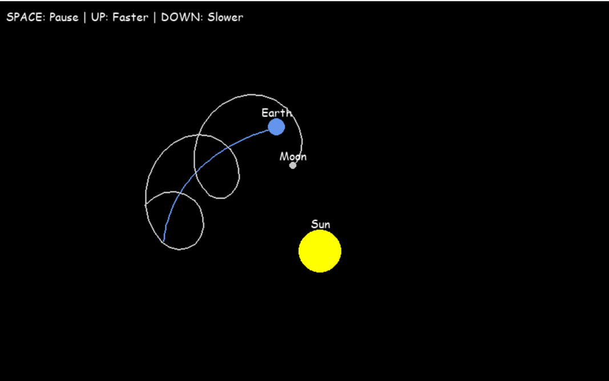

# Sun-Earth-Moon Simulation

A 2D orbital motion simulation of the Sun, Earth, and Moon developed using **Python** and **Pygame** as a project for the Simulation and Modeling (SNM) subject.

The simulation visually demonstrates the Earth revolving around the Sun and the Moon revolving around the Earth, with animated orbital trails and interactive speed controls.

## Features

- **Sun Representation:** Displays the Sun at the center of the simulation.
- **Earth's Revolution:** Simulates Earth's elliptical orbit around the Sun.
- **Moon's Revolution:** Simulates the Moon orbiting around the Earth.
- **Orbit Trails:** Displays the recent movement paths of Earth and Moon.
- **Pause and Resume:** Pause or resume the simulation whenever needed.
- **Speed Control:** Increase or decrease the orbital speed using keyboard controls.
- **Smooth Animation:** Runs at 60 FPS for continuous motion.

## Technologies Used

- Python 3
- Pygame
- Math module

## Requirements

- Python 3.x
- Pygame

## Installation and Setup

**1. Clone the repository**

```bash
git clone https://github.com/AadityaNeupane23/SNM-Project.git
```

**2. Navigate to the project directory**

```bash
cd SNM-Project
```

**3. Install the required library**

```bash
pip install pygame
```

**4. Run the simulation**

```bash
python main.py
```

## Controls

| Key          | Action                    |
| ------------ | ------------------------- |
| `SPACE`      | Pause / Resume            |
| `UP ARROW`   | Increase simulation speed |
| `DOWN ARROW` | Decrease simulation speed |

## Preview



## Simulation Model

The simulation uses mathematical equations and angular kinematics to represent orbital motion.

- Earth's position is calculated using the parametric equations of an ellipse.
- The Moon's position is calculated relative to Earth's current position.
- Sine and cosine functions are used to calculate the positions of celestial bodies.
- Angular increments update the positions continuously in each frame.

**Note:** This is a simplified 2D visualization. It does not calculate actual gravitational forces, and the sizes, distances, and orbital speeds are not to scale.
